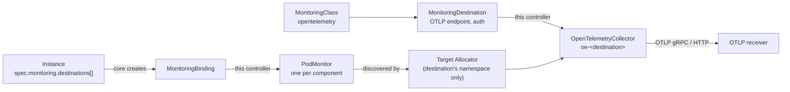

# monitoring-otel

> [!WARNING]
> **Experimental.** This repository is an experiment in sending OpenEverest metrics over OTLP.
> The design, CRD usage, chart values and defaults will change. Not for production use.

Send the metrics of [OpenEverest](https://github.com/openeverest/openeverest) database
instances to any [OTLP](https://opentelemetry.io/docs/specs/otlp/) receiver: Grafana Cloud,
Datadog, Elastic, Honeycomb, an OpenTelemetry Collector you run, or Prometheus, Mimir and
VictoriaMetrics through their OTLP endpoints.

## What this is

A monitoring extension for OpenEverest. It installs the `opentelemetry` `MonitoringClass` and
the controller that fulfils it. The class is **ExtensionManaged**: database providers only
publish metrics endpoints in `Instance.status.monitoring.sources`, and this controller collects
them with an [OpenTelemetry Collector](https://opentelemetry.io/docs/collector/) and exports
them over OTLP. Any provider that publishes metrics endpoints works; nothing is
provider-specific.

> [!IMPORTANT]
> **This extension is not standalone.** It requires an OpenEverest installation, the
> [OpenTelemetry Operator](https://github.com/open-telemetry/opentelemetry-operator), the
> Prometheus Operator CRDs (only the CRDs: `PodMonitor` is how targets reach the collector)
> and cert-manager. It installs none of them.

## Compatibility

| monitoring-otel | OpenEverest | OpenTelemetry Operator |
|---|---|---|
| `0.1.x` | `2.0.0-alpha.1` | `v0.162` or later |

The chart and its `MonitoringClass` carry the annotation `openeverest.io/contract-version`, the
contract version of the OpenEverest the controller is built against. It names the oldest
OpenEverest the build works with.

## How it fits



1. **Destination → collector.** For every accepted `MonitoringDestination` of the class, the
   controller applies an `OpenTelemetryCollector` named `oe-<destination>` in the destination's
   namespace, owned by the destination. It is a single-replica StatefulSet with a Target
   Allocator, a `prometheus` receiver, `memory_limiter` and `batch` processors and an `otlp`
   (gRPC) or `otlphttp` exporter.
2. **Binding → PodMonitors.** For every accepted binding, the controller applies one
   `PodMonitor` per component, exactly as
   [monitoring-prometheus](https://github.com/openeverest/monitoring-prometheus) does, labelled
   with the destination and class. The collector's Target Allocator selects only those labels,
   only in its own namespace (`allowNamespaces`), and drops endpoints that reference files
   (`denyFSAccessThroughSMs`). Adding or removing Instances does not restart the collector.
3. **Credentials by reference.** The destination's credentials Secret reaches the collector
   as `secretKeyRef` environment variables expanded by the `basicauth` or `bearertokenauth`
   extension or a header. The destination's CA bundle is mounted from its Secret. The
   controller never reads a Secret.
4. **Readiness from what is exported.** Every minute the controller reads the collector's own
   telemetry (`:8888/metrics`) and sets the destination's `Ready` from the exporter counters
   since the last probe: `Ready` while points are accepted, `Unauthorized` when the receiver
   rejects every point with `Unauthenticated` or `PermissionDenied`, `Unreachable` for any
   other failure. Core mirrors this onto every Instance that sends there.

Every series carries the contract's identity labels (`openeverest_instance`,
`openeverest_namespace`, `openeverest_provider`, `k8s_cluster_id`, `openeverest_component`,
`openeverest_kind`), the same as with the other ExtensionManaged classes.

## Destinations

| Parameter | Default | Purpose |
|---|---|---|
| `endpoint` | required | OTLP receiver URL. For `grpc`, the server address (`https://otlp.example.com:4317`); for `http/protobuf`, the base URL the exporter appends `/v1/metrics` to. `http://` means plaintext. |
| `protocol` | `grpc` | `grpc` or `http/protobuf`. |
| `headers` | none | Extra, non-secret headers (e.g. `X-Scope-OrgID`). `Authorization` is refused here. |
| `apiKeyHeader` | none | Header the `APIKey` credential goes in (e.g. `x-honeycomb-team`, `DD-API-KEY`). |
| `compression` | `gzip` | `gzip`, `zstd` or `none`. |
| `interval` | `30s` | Scrape interval. |

| Authentication mode | Secret keys | Sent as |
|---|---|---|
| `Anonymous` | none | nothing |
| `BasicAuth` | `username`, `password` | `basicauth` extension |
| `BearerToken` | `token` | `bearertokenauth` extension |
| `APIKey` | `apiKey` | the `apiKeyHeader` header |

`spec.tls` of the destination sets the CA bundle (`ca.secretKeyRef`) or skips verification.

```yaml
apiVersion: v1
kind: Secret
metadata: {name: grafana-cloud, namespace: team-a}
stringData: {username: "123456", password: glc_...}
---
apiVersion: monitoring.openeverest.io/v1alpha1
kind: MonitoringDestination
metadata: {name: grafana-cloud, namespace: team-a}
spec:
  classRef: {name: opentelemetry}
  authentication:
    mode: BasicAuth
    credentialsSecretRef: {name: grafana-cloud}
  parameters:
    endpoint: https://otlp-gateway-prod-eu-west-2.grafana.net/otlp
    protocol: http/protobuf
```

## Prerequisites

- OpenEverest `2.0.0-alpha.1` or later.
- [cert-manager](https://cert-manager.io): the OpenTelemetry Operator webhook, and mTLS between
  each Target Allocator and its collector (`collector.targetAllocatorMTLS`, on by default), so
  Secrets referenced by PodMonitors (scrape basic auth, TLS CAs) can be handed to the collector.
- The OpenTelemetry Operator, with a collector image that has the `prometheus` receiver, the
  `otlp` and `otlphttp` exporters and the `basicauth` and `bearertokenauth` extensions, e.g.
  `otel/opentelemetry-collector-k8s` (`manager.collectorImage.repository` of its chart).
- The Prometheus Operator CRDs, e.g. the `prometheus-community/prometheus-operator-crds` chart.

## Installation

```bash
helm install monitoring-otel charts/monitoring-otel -n everest-system \
  --set image.repository=<image> --set image.tag=<tag>
kubectl get monitoringclass opentelemetry
```

| Chart value | Default | Purpose |
|---|---|---|
| `class.create` | `true` | Install the `MonitoringClass` |
| `class.name` | `opentelemetry` | Name of the class |
| `class.controllerName` | `openeverest.io/monitoring-otel` | Controller name the class is claimed by |
| `collector.image` | operator default | Collector image |
| `collector.targetAllocatorMTLS` | `true` | mTLS between Target Allocator and collector |
| `compatibility.acknowledge.coreVersion` | `""` | OpenEverest release on which to run this build although it does not support it, such as `2.0.0` |

The chart also installs a `<release>-target-allocator` ClusterRole. The controller binds it,
with a RoleBinding in the destination's namespace only, to each collector's Target Allocator,
and its own RBAC allows binding that role and no other.

## Experiment results

Run on LKE (Kubernetes 1.37, 3 × 8 GB nodes) with OpenEverest `2.0.0-alpha.1`,
provider-percona-server-mongodb `0.6.1` (3-member replica set), provider-cloudnative-pg `0.4.2`,
OpenTelemetry Operator `0.162.0` and collector `otelcol-k8s 0.162.0`.

| Check | Result |
|---|---|
| Class claimed; core computes compatibility per provider with no core change | ✅ PSMDB `ExtensionManaged`, `RollingRestart` (exporter sidecar); CNPG `ExtensionManaged`, `None` |
| Anonymous OTLP/HTTP to Prometheus 3 (`--web.enable-otlp-receiver`) | ✅ both providers, all identity labels |
| BasicAuth OTLP/HTTP to VictoriaMetrics, with an extra header | ✅ |
| OTLP/gRPC to a collector | ✅ |
| One shared collector serves Instances of different providers | ✅ MongoDB and PostgreSQL through the same collector |
| Wrong password → destination `Unauthorized`, Instance entry `DestinationNotReady` | ✅ within one probe |
| Password fixed (and collector restarted) → `Ready` again | ✅ |
| Instance entry removed → its PodMonitor pruned, Target Allocator drops the job | ✅ no collector restart |
| Destination deleted → collector, Target Allocator, RoleBinding and certificates collected | ✅ |
| Scrape endpoints that need Secrets (CNPG metrics TLS, OpenSearch basic auth) via TA mTLS | ⚠️ not exercised: mTLS certificates were issued, but no Instance on the stand published such an endpoint |

Footprint per destination: the collector used 126–147 MiB scraping two Instances (about
6.5k series for the MongoDB replica set and 600 for PostgreSQL per scrape), the Target
Allocator about 30 MiB; the controller 15 MiB.

## Findings and open questions

1. **No core change is needed for metrics.** The ExtensionManaged contract
   (`status.monitoring.sources`, identity, credential profiles) was enough for a generic OTLP
   class. Reusing the PodMonitor rendering of monitoring-prometheus made it the same code path.
2. **Credential rotation is not picked up.** Environment variables from a Secret are fixed when
   the collector pod starts, so editing the destination's Secret changes nothing until the pod
   restarts. Fix options: watch only the metadata of referenced Secrets
   (`PartialObjectMetadata`, no data access) and stamp their `resourceVersion` into the
   collector's pod annotations; or mount the Secret as files, which still needs a restart since
   the collector does not reload.
3. **One collector per destination is simple but not free:** two pods, about 160–180 MiB and three
   cert-manager Certificates per destination, running even before any Instance is bound.
   Alternatives: create the collector only while the destination has bindings, or run one
   collector per namespace with one exporter per destination and a `routing` connector keyed
   on the destination label.
4. **Prometheus Operator CRDs are required without running Prometheus**, because the Target
   Allocator discovers targets through PodMonitors. The alternative, inline `scrape_configs`
   in the collector, would restart the collector whenever an Instance is added and would need
   scrape Secrets mounted into it.
5. **The Target Allocator can read every Secret in its namespace.** It needs Secrets to resolve
   PodMonitor references (scrape basic auth, TLS CAs), and Roles cannot be narrowed to unknown
   names. The scope is one namespace, and file references are denied. It could be narrowed by
   granting Secrets and enabling mTLS only while a bound Instance publishes an endpoint that
   references one.
6. **Readiness comes from the collector, not from a probe.** That keeps the "never read a
   Secret" rule and reports real delivery, including `Unauthorized`, from `error.type` at
   `detailed` telemetry level. But a destination nothing sends to yet reads `Ready` ("nothing
   exported yet") even if its endpoint is wrong. Collector versions also differ in whether
   counters carry `_total`; both are accepted.
7. **Attributes are Prometheus-shaped.** Identity labels are datapoint attributes, and
   `job`/`instance` become `service.name`/`service.instance.id`. OTel-native backends
   (Datadog, Honeycomb) group by resource attributes, so a `transform` processor promoting
   the identity to resource attributes (`k8s.namespace.name`, `openeverest.instance`, …) is
   worth deciding before a stable release.
8. **Collector config changes roll the collector** (for example the telemetry level), while
   Instance changes do not. Parameter edits on a destination briefly interrupt its export.
9. **The OpenTelemetry Operator webhook warns** about cluster-scoped rules (nodes,
   nonResourceURLs) missing from the Target Allocator's ServiceAccount, although discovery is
   namespace-scoped and works. The warnings are logged once per destination.
10. **Logs are the next step.** They need a `logs` signal in the provider contract (most engines
    write their slow and error logs to files, not stdout) and a node agent that holds no
    destination credentials and forwards to the per-destination collectors.

## Development

```bash
make test-unit   # unit tests
make lint        # golangci-lint
make helm-lint   # chart lint
make generate    # stamp the chart with the OpenEverest contract version
make verify      # fail on stale generated files or a missing stamp
make run         # run against the current kubeconfig
```

## License

Apache 2.0, see [LICENSE](LICENSE).
